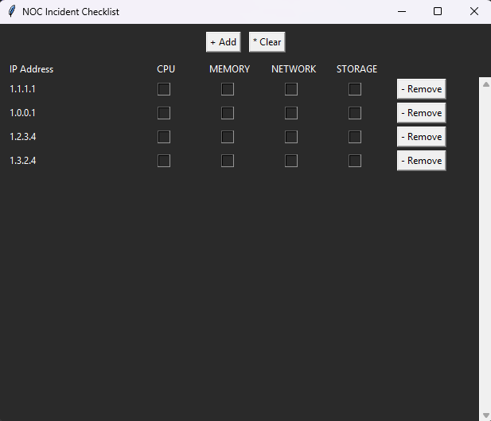

# NOC Health and Incident Checklist

I made this app to keep track of what I have checked and what I haven't,
so I don't miss any daily check on any VM. I built it for personal use,
to make NOC work easier, and as a portfolio project.

## Screenshot




## Features

- Add custom rows manually (for example IP address, hostname, or ID)
- Four checkboxes per row: CPU, MEMORY, NETWORK, STORAGE
- Clear button that unticks all boxes in every row
- Scrollable list for long checklists

## How to run

1. Install Python 3.
2. Open a terminal in the project folder.
3. Run `py main.py`.

## How it works

When you add a row, tick a box, or remove a row, the app saves your
changes to `checklist.json` in this format:

```json
{
  "text": "1.1.1.1",
  "checks": [false, false, false, false]
}
```

`text` is the label of the row. It can be anything you like.
`checks` holds the checkbox states in this order: CPU, MEMORY, NETWORK, STORAGE.

## What I learned from this project

- Building a user interface with tkinter
- Saving and loading data with a JSON file
- Making a long list scrollable
- Debugging by reading Python error messages

## Future improvements

- A note button on every row, so I can write notes about anything I
  need to report. NOC engineers write reports, and this version has no
  issue notes yet.
- An automatic report generator that saves a document with the time, the
  items I checked, and my notes, so the report is easier to read.