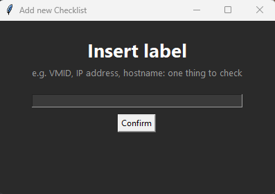

# NOC Health and Incident Checklist

I made this app to check what i've done and what isn't
so i will not miss any daily check on every VM
I made this for making NOC job easier and personal use
Made for portfolio

## Screenshot

## Features

- Manually add custom rows eg. IP Address, Hostname, ID, etc.
- Respective checkboxes for each row
- Clear all mark from all rows
- Scrollable rows for very long rows

## How to run

1. Install python
2. Use "py main.py" in console

## How it works

On add, tick and remove the app will save your action in checklist.json file with this format
    "text": "1.1.1.1",
    "checks": [
      false,
      false,
      false,
      false
    ]
text is the label of your row it can be anything you like
checks is the checkbox with order of CPU, MEMORY, NETWORK, STORAGE

## What i learned from this project

- What NOC really do daily
- Create UI with tkinter
- Make JSON save file
- Debugging

## Future Improvements

- I know this project have a problem when we working as NOC we wrote report and this doesn't have Issues note yet so in future update of this code i'll add a button on every row to be able to add note on any row that I have something to say
- I like to add auto report generator that will print reported file in a document file for easier read and report what i've done and what i've checked also noted area

This project i made I focusing on personal use and put on portfolio